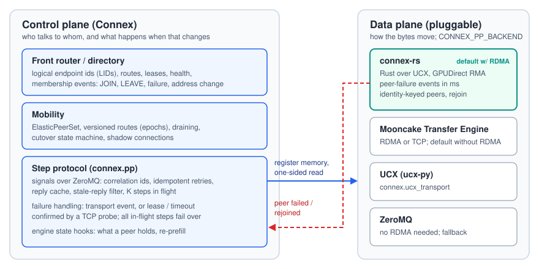
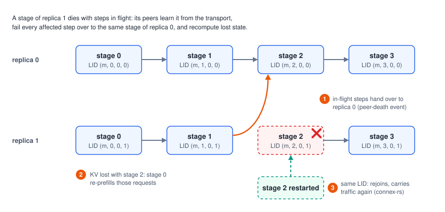
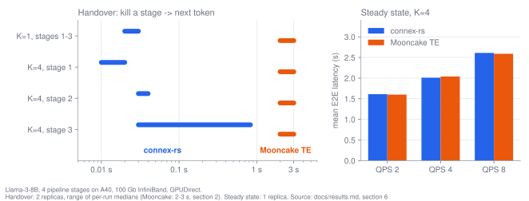

<p align="center">
  <picture>
    <source media="(prefers-color-scheme: dark)" srcset="docs/assets/connex-logo-dark.svg">
    
  </picture>
</p>

<p align="center"><b>Endpoint mobility primitives for dynamic LLM serving</b><br>
communication endpoints that join, leave, fail and migrate with traffic in flight</p>

<p align="center">
  <a href="https://github.com/HeterInfra/connex/actions/workflows/ci.yml"></a>
  <a href="LICENSE"></a>
  
  <a href="https://pypi.org/project/connex-ai/"></a>
  <a href="https://github.com/HeterInfra/connex-rs"></a>
  <a href="#citation"></a>
</p>

Connex is a communication library for distributed AI infrastructure, built
on **endpoint mobility primitives**: communication endpoints that join,
leave, fail and migrate while traffic to them is in flight. Its target is
distributed and heterogeneous LLM serving in which many replicas of a
distributed model run side by side (several pipeline chains, pools of
prefill and decode instances, attention and FFN workers) on mixed hardware
and transports, and the set of endpoints changes all the time. Every
endpoint has a stable logical identity that a control plane resolves to its
current address; senders keep in-flight work correct when the endpoint
behind an identity changes, so requests hand over to another replica on
failure or scale-down and new replicas take traffic as soon as they join.

Tensor bytes move through a pluggable data plane. On RDMA hosts the default
is [**connex-rs**](https://github.com/HeterInfra/connex-rs), Connex's own Rust data plane over UCX:
GPUDirect one-sided transfers as fast as Mooncake Transfer Engine, plus
peer-death events within milliseconds and same-identity rejoin, which bring
handover after a killed stage from 2-3 s to well under 1 s
([comparison](https://github.com/HeterInfra/connex-rs#performance-vs-mooncake-transfer-engine)).
Mooncake Transfer Engine, UCX and ZeroMQ remain available.

Connex is the system described in *Connex: Endpoint Mobility Primitives for
Dynamic LLM Serving* (SIGCOMM 2026, see [Citation](#citation)).

## Highlights

- 🔁 **In-flight handover across replicas.** Kill a pipeline stage
  mid-generation and its in-flight steps move to the same stage of another
  replica: all 32 affected requests complete with 0 non-argmax tokens; a
  larger campaign (72 kill runs, 518,400 tokens) found 0 non-argmax tokens.
- ⚡ **Sub-second failover with connex-rs.** Peer-death events from the
  transport bring kill-to-next-token from 2-3 s (Mooncake TE, lease + probe)
  to 0.01-0.83 s with 4 steps in flight, at the same steady-state latency.
- 📈 **Elastic by construction.** Replicas join and leave a running
  deployment; with a replica killed every 60 s goodput stays at 99.2-99.6 %,
  and 100 % with the resume proxy.
- 🧩 **Pluggable data plane.** connex-rs, Mooncake Transfer Engine, UCX or
  ZeroMQ behind a seven-method interface; none of the mobility logic lives in
  the transport.
- 🚀 **Runs where you are.** CPU-only demo, one GPU box with docker compose,
  several RDMA hosts, or Kubernetes; `pip install connex-ai`.

## Contents

- [Why: dynamic serving needs mobile endpoints](#why-dynamic-serving-needs-mobile-endpoints)
- [Core abstractions](#core-abstractions)
- [Scenarios and status](#scenarios-and-status)
- [Library layout](#library-layout)
- [Architecture: Connex control, pluggable data plane](#architecture-connex-control-pluggable-data-plane)
- [Integration: multi-replica pipeline-parallel serving with vLLM](#integration-multi-replica-pipeline-parallel-serving-with-vllm)
- [Results](#results)
- [Install](#install)
- [Configuration](#configuration)
- [Limitations](#limitations)
- [Contributing](#contributing) · [Citation](#citation) · [License](#license)

## Why: dynamic serving needs mobile endpoints

Collective communication libraries assume that the set of peers is fixed at
start-up: a rank is an address, and a lost rank ends the job. Production
serving breaks that assumption. Replicas are added and removed with load,
fail and are replaced, move to other nodes or hardware, and one request is
increasingly served by several role-specialised instances (pipeline stages,
prefill and decode, attention and FFN) that talk over the network. In all of
these, the peer of a running request can change while its data is in
flight. Restarting the whole replica, or dropping its requests, turns every
scale or failure event into user-visible errors. Connex treats this as a
communication problem: it gives the application a mobile endpoint and a
delivery contract that survives the endpoint moving. The design rationale
is in [`docs/design/overview.md`](docs/design/overview.md).

## Core abstractions

| Abstraction | What it is | Where |
|---|---|---|
| Logical endpoint id | `LID = (model, stage, shard, replica[, pd_role])`; addressing, routing and failure handling refer to LIDs, never to sockets. Replicas of the same role share everything but `replica` | `connex.protocol` |
| Directory / front-router | routes, leases, health and membership events (JOIN, LEAVE, failure, address change); senders resolve LIDs here instead of using fixed ranks | `connex.front_router`, `connex.directory`, `connex.directory_server` |
| Join / leave / migrate | register, deregister or re-register a LID with a new address while others keep running; `ElasticPeerSet` turns membership into connected, routable peers without blocking the sender | `connex.directory`, `connex.elastic` |
| Cutover | versioned routes (epochs), draining routes, a cutover state machine and shadow connections for switching a LID to a new endpoint | `connex.mobility_control`, `connex.cutover_fsm`, `connex.route_table` |
| Step delivery contract | correlation ids, idempotent retried sends and receives, reply cache, stale-reply filter, K steps in flight; this is what makes re-sending in-flight work to another replica safe | `connex.pp` |
| Fast handover and state hooks | a missed lease or receive timeout, confirmed by a TCP probe, fails all affected steps over at once (2-3 s kill to next token, measured); the engine reports which state a peer held, and lost state is recomputed instead of continued | `connex.pp`, engine adapters |
| Transports | [connex-rs](https://github.com/HeterInfra/connex-rs) (Rust over UCX: RDMA/TCP, GPUDirect, peer-death events, same-identity rejoin; default with RDMA), Mooncake Transfer Engine (RDMA/TCP, GPUDirect or host staging), UCX via ucx-py, ZeroMQ fallback, per-peer capability negotiation | `connex_rs` ([separate repository](https://github.com/HeterInfra/connex-rs), `third_party/connex-rs`), `connex.pp.endpoint`, `connex.ucx_transport`, `connex.mooncake_integration`, `connex.gpu_fastpath` |
| Resume proxy | optional OpenAI-API proxy that retries a request before its first token, or resumes it on another replica after k tokens, when a front-end replica dies | `connex.serving.proxy` |

A small example, CPU only and not tied to any serving scenario: a sender
talks to two replicas of one logical group, survives one of them dying with
a step in flight, sees it rejoin, follows a migration to a new address and
a scale-down. The group could be a decode pool, FFN workers or one stage of
several pipeline replicas. Full script: [`examples/mobile_endpoints.py`](examples/mobile_endpoints.py).

```python
from connex.directory import DirectoryClient
from connex.directory_server import DirectoryServer
from connex.elastic import ElasticPeerSet

directory = DirectoryServer("127.0.0.1:7000", "127.0.0.1:7001")  # routes, leases, events
directory.start()

# each replica JOINs under LID ("demo", group=1, shard=0, replica=r)
a = DirectoryClient(directory.bind_addr, "demo", stage_idx=1, replica_idx=0,
                    local_addresses=[addr_a]); a.start(); a.register()
b = DirectoryClient(directory.bind_addr, "demo", stage_idx=1, replica_idx=1,
                    local_addresses=[addr_b]); b.start(); b.register()

# the sender resolves the group through the directory, not fixed ranks
owner = DirectoryClient(directory.bind_addr, "demo", stage_idx=0); owner.start()
peers = ElasticPeerSet(owner, transport, stage_idx=1)
peers.start(); peers.wait_ready(2)
peers.send(peers.pick(), b"step")

peers.mark_failed(("demo", 1, 0, 1))    # replica 1 died: evicted for every sender
peers.send(peers.pick(), b"step-42")    # in-flight step handed over to replica 0
b.register()                            # replica 1 rejoins (scale up)
a.register(addresses=[new_addr_a])      # replica 0 migrates, same LID
b.deregister()                          # scale down
```

<details>
<summary>Output</summary>

```
$ python examples/mobile_endpoints.py
replicas:   [('demo', 1, 0, 0), ('demo', 1, 0, 1)]
received:   b'step' b'step'
handover:   [('demo', 1, 0, 0)] b'step-42'
rejoin:     [('demo', 1, 0, 0), ('demo', 1, 0, 1)]
migrate:    b'after-migrate'
scale-down: [('demo', 1, 0, 0)]
```

</details>

`examples/two_stage_pipeline.py` shows directory discovery plus a tensor
transfer, and `make cpu-demo` the resume proxy surviving a backend kill.

## Scenarios and status

The primitives are generic; how far each scenario is integrated with an
inference engine differs, and this table says so plainly. **Multi-replica
pipeline parallelism is the first scenario that is fully integrated and
validated end to end on GPUs** (vLLM, Llama-3-8B, 4 stages, replicas joining
and leaving, see [`docs/results.md`](docs/results.md)). A single pipeline
chain is only the building block; the interesting cases are several replica
chains whose stages fail over to each other.

| Scenario | What exists in this repository | Status |
|---|---|---|
| Pipeline parallelism, many replica chains | `connex.pp` core, vLLM adapter and engine patches, SGLang communication prototype, compose and k8s deployment | **Implemented and validated** on GPUs (vLLM); SGLang adapter is communication-side only |
| Elasticity: scale up / down | front-router registration, leases and membership events; `ElasticPeerSet`; sticky replica-aligned chains in `connex.pp` | **Implemented and validated**: replicas join and leave a running deployment (`docs/design/elastic-scaling-performance.md`) |
| Failover with in-flight request handover across replicas | correlation ids, idempotent retried steps, fast handover, re-prefill (`connex.pp`); resume proxy (`connex.serving.proxy`) | **Implemented and validated** for pipeline stages (all requests complete, greedy output correct, 2-3 s handover) |
| Endpoint migration (same identity, new address) | re-registration with `address_changed`; MIGRATE handling in `ElasticPeerSet`; cutover state machine and shadow connections | Implemented, partly unit-tested; **not validated at scale** (re-adding a stage under the same identity has a known Mooncake limitation, see Limitations) |
| Heterogeneous transports and hardware | connex-rs and Mooncake (RDMA/TCP, GPUDirect or host buffers), UCX, ZeroMQ, capability negotiation | Transports **validated** (RDMA and TCP, GPUDirect and host staging); mixed GPU types in one deployment **not validated** |
| Prefill-decode (PD) disaggregation, prefill and decode pools | role-aware endpoint ids (`PDRole`), role lookup in `VersionedRouteTable`, KV block transfer manager (`connex.mooncake_integration`) | **Primitives available** (unit-tested in `tests/test_pd_primitives.py`); **engine integration on the roadmap** |
| Attention-FFN disaggregation | the generic primitives only | **Roadmap**: no attention/FFN-specific code yet |

## Library layout

| Layer | Package | Role |
|---|---|---|
| control plane | `connex.front_router`, `connex.directory*`, `connex.epc_*` | logical endpoint registry: routes, leases, health, membership and migration events |
| mobility | `connex.elastic`, `connex.cutover_fsm`, `connex.mobility_control`, `connex.route_table` | elastic peer sets, versioned routes, cutover state machine, shadow connections |
| transports | [connex-rs](https://github.com/HeterInfra/connex-rs) (default data plane with RDMA; submodule `third_party/connex-rs`), `connex.pp.endpoint`, `connex.ucx_transport`, `connex.mooncake_integration` | tensor transport over RDMA or TCP; KV block transfer for PD |
| step protocol | `connex.pp` | `PipelineEndpoint`, correlation ids, K in flight, idempotent retries, sticky failover, handover, the `EngineHooks` protocol, wire format |
| engine adapters | `connex.adapters.vllm`, `connex.adapters.sglang` | vLLM communicator for the fork's external pipeline mode (plus patches in `integrations/vllm/patches`); SGLang `pp_group` replacement (prototype) |
| serving | `connex.serving.proxy` | optional request retry/resume proxy |

## Architecture: Connex control, pluggable data plane

Connex separates *who talks to whom, and what happens when that changes*
from *how the bytes move*. Connex owns the first part. The second part is a
pluggable data plane. On RDMA hosts the default is **connex-rs**
([HeterInfra/connex-rs](https://github.com/HeterInfra/connex-rs),
`pip install "connex-ai[rs]"`), Connex's own data plane in Rust over UCX; the [Mooncake Transfer Engine](https://github.com/kvcache-ai/Mooncake)
remains supported (`CONNEX_PP_BACKEND=mooncake`) and is the default where no
RDMA device is present. "ConnexTE" names the combination of Connex control
with a transfer-engine data plane.

<p align="center">
  
</p>

One step from a sender to its peer works like this. The sender copies the
tensors into a send ring it registered with the data plane (GPU memory when
GPUDirect is on, `CONNEXTE_GDR=1`, the default; host memory otherwise) and
sends a small ZeroMQ signal with the correlation id, the tensor layout and
the ring offset. The receiver pulls the payload with one one-sided RDMA read
into its own registered buffer and acknowledges, which frees the ring slot.
Everything around that read is Connex: which peer the step goes to, what a
timeout or a dead peer means, retrying without executing a step twice,
dropping late replies, re-sending all in-flight steps to another replica,
and asking the engine to recompute state the new peer does not hold.

<details>
<summary>Who owns what</summary>

| Concern | Owner |
|---|---|
| Moving tensor bytes: RDMA/TCP transfers, memory registration, GPUDirect | data plane (connex-rs with RDMA, else Mooncake TE) |
| Endpoint identity, discovery, leases, membership, migration | Connex control plane |
| Step signalling, correlation, idempotent retry, stale-reply filter | Connex (`connex.pp`) |
| Peer-death events within milliseconds; same-identity rejoin of a single stage | connex-rs (UCX endpoint errors, identity-keyed connections) |
| Failure handling: failing all in-flight steps over at once; lease + TCP probe for hung or partitioned peers | Connex (`connex.pp`) |
| What state a peer holds, re-prefill after handover | Connex hooks, implemented by the engine adapter |
| Request retry/resume across front-end replicas | Connex resume proxy (optional) |

</details>

The data plane is an interface, not a dependency. `connex.pp` uses only
seven methods of a transfer engine (`register_memory`, `unregister_memory`,
`transfer_sync_read`, managed-buffer allocation and copies; see the
`TransferEngine` protocol in `connex/pp/transports.py`), and the unit tests
run the whole step protocol, failover included, against an in-memory fake.
Another RDMA library can be plugged in by implementing that protocol.
`CONNEX_PP_BACKEND` selects it: `auto` (default: connex-rs when installed
and an RDMA device is present, else Mooncake, else ZeroMQ), `connex-rs`,
`mooncake` or `zmq`. None of the mobility logic lives in the data plane, and
Connex does not modify Mooncake.

What connex-rs adds over a plain transfer engine is that the transport
itself reports peers: a process that dies is reported to every stage linked
to it within milliseconds (its kernel tears down the UCX connections), and
connections are keyed by logical endpoint id, so a single stage restarted
under the same identity rejoins without restarting its chain. `connex.pp`
uses these events as its primary failure signal and keeps the router lease
and the TCP probe for hung or partitioned peers (a heartbeat on the
transport's own progress thread, 1 s / 3 s, only raises a suspicion). With
the same 4-stage, 2-replica Llama-3-8B layout, killing a stage resumes its
in-flight requests 0.01-0.9 s after the kill (K=4) instead of 2-3 s, and
steady-state latency and throughput match Mooncake
([`docs/results.md`](docs/results.md)).

An engine implements a small contract: send and receive a tensor dict at step
boundaries, report per request what state it holds, release finished
requests, and recompute requests reported missing
([`docs/design/engine-contract.md`](docs/design/engine-contract.md)).
`import connex` and `import connex.pp` need no inference engine.

## Integration: multi-replica pipeline-parallel serving with vLLM

Each pipeline stage runs as its own vLLM process and registers as a LID
`(model, stage, 0, replica)`. Several replica chains share one front-router;
a stage-0 replica keeps its traffic on its own chain and, when a downstream
stage dies, hands its in-flight steps to the same stage of another replica
(re-prefilling requests whose KV died with it). Stage-0 deaths are covered
by the resume proxy.

<p align="center">
  
</p>

Clients reach stage 0 of either replica directly or through the optional
resume proxy; every stage registers, heartbeats and receives membership
events through the Connex front-router (routes, leases, health).

It needs a vLLM fork with an **external pipeline mode**
(`--pipeline-stage-mode external`, one process per stage); upstream vLLM has
neither the mode nor a plugin hook for pipeline communicators. The image
build (`docker/Dockerfile`) installs the fork, copies the communicators and
applies the engine patches (K steps in flight, re-prefill, downstream CUDA
graphs and external-PP fixes); see
[`integrations/vllm/README.md`](integrations/vllm/README.md).

> **About `VLLM_FORK_REPO`.** The external-PP vLLM fork is not part of this
> repository and is not yet published, so the image build has no default for
> it: `VLLM_FORK_REPO` is a placeholder for the git URL of a copy of that
> fork you can access (the integration is validated at fork commit
> `380186d57`, the default `VLLM_FORK_REF`). The library, the CPU-only demo
> and the test suite need neither the fork nor a GPU.

Quick start on one host with GPUs (two replicas of a 2-stage Llama-3-8B
pipeline; four GPUs, or two GPUs of 40 GB or more with `GPU2=0 GPU3=1
GPU_MEM_UTIL=0.4`, started one replica after the other as in `docs/deploy.md`):

```bash
make image IMAGE=connex-vllm:dev VLLM_FORK_REPO=<git URL of the external-PP vLLM fork>
export CONNEX_IMAGE=connex-vllm:dev HF_TOKEN=hf_...
docker compose -f docker/docker-compose.yml --profile proxy up -d
docker/smoke_test.sh                          # replica 0
docker/smoke_test.sh http://127.0.0.1:8010    # replica 1
docker/smoke_test.sh http://127.0.0.1:5199    # through the resume proxy
docker compose -f docker/docker-compose.yml kill stage1-r1   # replica 1's requests hand over to replica 0's stage 1
```

[`docs/deploy.md`](docs/deploy.md) covers every tier with copy-pasteable
commands: CPU-only demo, one GPU box (docker compose), several hosts with
RDMA or TCP, and Kubernetes (`deploy/k8s/manifests.py`).

## Results

<p align="center">
  
</p>

The chart compares the two RDMA data planes on the same deployment
(numbers from [`docs/results.md`](docs/results.md), section 6; regenerate with
`python docs/assets/src/results_chart.py`). The results below are on a
4-stage Llama-3-8B pipeline on A40 nodes with InfiniBand (Mooncake TE over
RDMA); full tables and reproduction commands are in
[`docs/results.md`](docs/results.md):

- **Steady state.** K=4 steps in flight keeps 100 % goodput up to QPS 8 with
  2.58 s mean / 9.95 s P99 E2E latency at QPS 8, against 6.01 s / 24.07 s for
  K=1; closed-loop throughput is 1.23-1.40x that of K=1.
- **In-flight handover.** Killing stage 1, 2 or 3 of a replica
  mid-generation completes all 32 affected requests with 0 non-argmax tokens
  (teacher-forced check), handover 2.2-2.9 s from kill to next token. A
  larger campaign (72 kill runs, 518,400 tokens) found 0 non-argmax tokens.
- **Churn.** With a replica killed every 60 s, goodput is 99.2-99.6 % at QPS
  2-8; every lost request was on the killed replica's own stage 0. With the
  resume proxy it is 100 %. Soft churn (deregistration) is 100 % without it.
- **Proxy cost.** ~0.03-0.05 s mean and ~0.1-0.2 s P99 E2E in steady state.

## Install

Python 3.10 or newer. The distribution on PyPI is **`connex-ai`**; the
import name is `connex`.

```bash
pip install connex-ai                # core: torch, pyzmq, msgpack, numpy, safetensors
pip install "connex-ai[proxy]"       # + aiohttp, for connex.serving.proxy
pip install "connex-ai[rs]"          # + connex-rs data plane (connex-rs>=0.1,<0.2)
pip install "connex-ai[mooncake]"    # + Mooncake Transfer Engine
pip install "connex-ai[ucx]"         # + ucx-py (CUDA 12 build)
pip install "connex-ai[vllm]"        # vLLM (the adapter needs the fork, see above)
pip install "connex-ai[sglang]"      # SGLang (adapter prototype)
pip install "connex-ai[rs,proxy,mooncake]"   # extras combine
```

From a checkout (development, tests, examples, deployment files):

```bash
pip install -e ".[test]"             # + pytest, pyflakes, aiohttp
python -m pytest -q tests            # CPU only
```

Optional dependencies degrade gracefully: without `ucx-py`, `UCXTransport`
logs a warning and uses ZeroMQ; `connex.pp` uses connex-rs, else Mooncake,
else a ZeroMQ-only data path. connex-rs is its own package and repository
([HeterInfra/connex-rs](https://github.com/HeterInfra/connex-rs)). For RDMA and GPUDirect, build its wheel
against a UCX with verbs/rdmacm and CUDA support from the
`third_party/connex-rs` submodule (Rust toolchain, maturin; see
[CONTRIBUTING.md](CONTRIBUTING.md)); the image build does this.

## Configuration

Every component is configured through environment variables or flags:
the stage entrypoint, front-router and control plane, the ConnexTE and UCX
data planes, the vLLM engine patches and the resume proxy. All of them, and
the benchmark tools, are listed in
[`docs/configuration.md`](docs/configuration.md). Image build arguments are
in [`docs/deploy.md`](docs/deploy.md).

## Limitations

- **Only pipeline parallelism is integrated with an engine.** PD
  disaggregation has primitives but no engine integration in this
  repository; attention-FFN disaggregation is roadmap.
- **vLLM fork required.** vLLM support needs the external-PP vLLM fork. The
  communicators and patches use vLLM internals and are not a plugin for
  upstream vLLM.
- **Handover after a process death is well under 1 s with connex-rs**
  (transport event), **2-3 s with Mooncake** (router lease or a 3 s
  data-path timeout, plus probe). A hung or partitioned peer (alive kernel,
  no RST) is still found by the heartbeat or lease plus probe, i.e. in
  seconds; node loss and partitions were not tested by cutting links.
- **SGLang is a prototype.** `connex.adapters.sglang` covers the
  communication side; the engine side (state report, re-prefill on the
  scheduling rank) is not implemented.
- **Stage-0 deaths need the proxy.** Without it, requests on a dying stage-0
  replica are lost. The proxy runs as a single replica, and its retry budget
  (`--max-attempts`, spent in under 0.5 s) does not span a ~1 s outage of the
  only endpoint; give it at least two stage-0 replicas.
- **UCX in TCP mode uses the eager protocol only**, so an abrupt peer kill
  can drop messages still in flight; retry at the request level. UCX is
  initialised once per process; run one `UCXTransport` per process.
- Each stage runs with tensor parallelism 1; re-prefill assumes stage 0 is a
  single TP=1 process that owns scheduling. Speculative decoding and
  structured output are not covered. A request is aborted after more than
  `CONNEX_PP_REPREFILL_MAX` (8) failovers.
- With Mooncake, re-adding a single killed stage under the same replica
  identity can break its peers; restart the whole replica chain. connex-rs
  supports single-stage rejoin.
- connex-rs without RDMA works but is slow (UCX emulates one-sided reads over
  TCP; GPU memory is staged through the host), which is why `auto` picks
  Mooncake there.
- Greedy decoding is not batch-invariant, so exact-match comparisons across
  runs differ at near-ties even without churn; use
  `benchmarks/k8s/failover_correctness.py score`.

## Contributing

See [CONTRIBUTING.md](CONTRIBUTING.md). Changes are listed in
[CHANGELOG.md](CHANGELOG.md).

<!-- release-scan: allow-begin -->
## Citation

If you use Connex in your research, please cite our paper:

```bibtex
@inproceedings{lin2026connex,
  title={Connex: Endpoint Mobility Primitives for Dynamic LLM Serving},
  author={Lin, Yanying and Liu, Vincent and Luo, Tao and Xu, Chengzhong and Ye, Kejiang},
  booktitle={Proceedings of the ACM SIGCOMM 2026 Conference},
  pages={46--59},
  year={2026}
}
```

<!-- release-scan: allow-end -->

## License

Apache-2.0, see [LICENSE](LICENSE).
