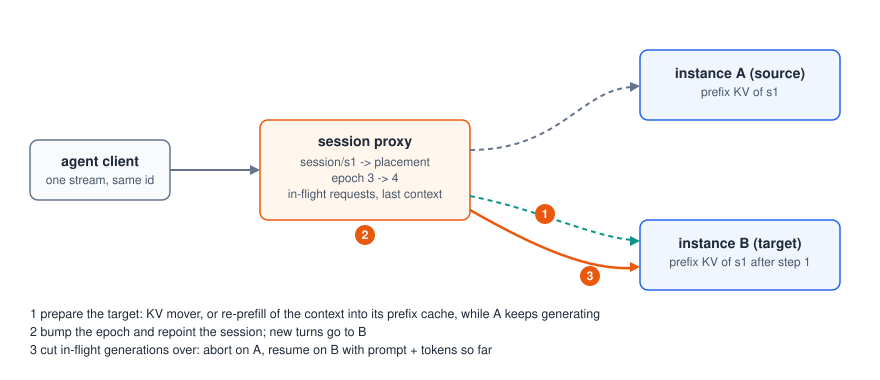

# Agent session migration (`connex.agents`)

<p align="center"></p>

A multi-turn agent session keeps its prefix state (KV cache) on one
serving instance. `connex.agents` gives each session a logical id with a
placement and an epoch, routes its turns to the placement, and moves it to
another instance (load balancing, scale-down, failure) while a generation
may be in flight, without the client noticing. Design:
[`design/rl-and-agent-migration.md`](design/rl-and-agent-migration.md).
Numbers: [`results.md`](results.md#8-agent-session-migration).

## Run it

`SessionProxy` is the resume proxy (`connex.serving.proxy`) plus a session
table. Point it at OpenAI-compatible engines with automatic prefix caching
(vLLM, SGLang):

```bash
python -m connex.agents.session --port 5299 \
    --endpoints http://127.0.0.1:8201,http://127.0.0.1:8202
# SGLang engines: add --no-token-ids (resume from text)
```

Clients send `session_id` in the request body (or the `X-Connex-Session`
header); the proxy strips it before the request reaches the engine. Admin
endpoints:

| Endpoint | Effect |
|---|---|
| `GET /sessions` | logical id, placement, epoch, in-flight count and recent moves of every session |
| `POST /sessions/{sid}/migrate` `{"target": URL, "mode": "auto"}` | migrate one session |
| `POST /sessions/drain` `{"url": URL}` | migrate every session off an instance (scale-down) |

From Python: `await proxy.migrate(sid, target, mode)` and
`await proxy.drain(url)`.

## What a migration does

1. **Prepare the target.** Movers are tried in order (`mode="auto"`):
   a `KVMover` that transfers the session's KV, then `ReprefillMover`, which
   re-prefills on the target what the session will send next (the prompt
   plus the tokens generated so far for an in-flight request, else the last
   completed context) so the target's prefix cache holds it. The source keeps
   generating meanwhile. `mode="none"` skips this step.
2. **Bump the epoch and repoint the session**: new turns go to the target.
3. **Cut in-flight generations over**: the proxy closes the backend stream
   (the engine aborts the request) and resumes it on the target with the
   prompt plus the tokens already sent. The client sees one stream with the
   same id; greedy output is identical to an unmigrated run.

If the placement dies, the next attempt goes to another instance, the epoch
increases and the move is recorded as a failover; that instance re-prefills
on demand.

## Benchmark

```bash
python benchmarks/agents/migration_bench.py \
    --engines http://127.0.0.1:8201,http://127.0.0.1:8202 --model q15 \
    --tokenizer /path/Qwen2.5-1.5B-Instruct --lengths 8192,30000 --out mig.jsonl
```

For each context length it measures the next turn's TTFT when the session
stays (sticky), after a cut-over-only migration (cold), and after a
migration with re-prefill; then migrates a long greedy generation mid-stream
and compares it with an unmigrated reference (identical text, largest gap
between tokens seen by the client). Each session's context starts with a
unique header, so no two sessions share a cached prefix.

## Status and limits

* Validated on GPUs with vLLM (`main`) and SGLang 0.5.22: sticky routing,
  migration with re-prefill, cut-over of in-flight generations with greedy
  output identical to an unmigrated run. Failover and drain are covered by
  the CPU tests. SGLang has no token-id logprobs in its completions API, so
  the proxy resumes from text there (`token_ids=False`).
* KV transfer between instances (instead of re-prefill) is a `KVMover`
  plug-in point; no KV mover ships yet. The planned path reuses the KV
  export/import layer of the prefill-decode work (vLLM KV connector API,
  SGLang HiCache storage backends) rather than adding a second connector.
* Chat requests resume from text (`continue_final_message`), completions
  from token ids; see the resume proxy's notes for sampling and `n > 1`.
* The session table lives in one proxy process.
