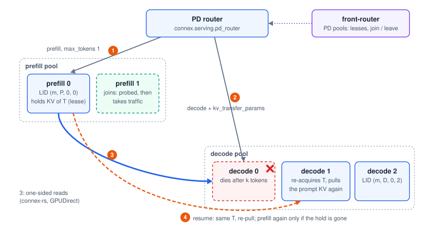

# Prefill-decode disaggregation with Connex

Connex runs prefill-decode (PD) disaggregation on **upstream vLLM and SGLang,
as plugins (no fork)**, and adds endpoint mobility to it: prefill and decode
instances can join, leave and fail while requests and KV transfers are in
flight. Status, measurements and what is not validated yet are at the end of
this page; the design notes and the problems found on the way are in
[`docs/design/pd-disaggregation.md`](design/pd-disaggregation.md).

<p align="center">
  
</p>

1. The **PD router** sends the prompt to a prefill instance (`max_tokens=1`,
   `kv_transfer_params={"do_remote_decode": true, ...}`).
2. It streams the request from a decode instance with the
   `kv_transfer_params` the prefill returned.
3. The decode instance **pulls** the prompt KV with one-sided reads
   (connex-rs over UCX with GPUDirect RDMA, or Mooncake Transfer Engine).
   The prefill instance keeps the blocks as a **hold** (a lease on transfer id
   T, renewed by every pull) until the decode instance releases them.
4. If the decode instance dies after k tokens, the router resumes the request
   on another decode instance with the prompt plus the k token ids; that
   instance pulls the same held KV again and computes only k tokens. Without
   the hold (prefill gone, lease expired) the request is prefilled again.

Pools are elastic: members come from URL lists, files the router re-reads
every second, or the Connex front-router (instances register their PD role).
A new member takes traffic once a probe succeeds; a member that leaves takes
no new requests and finishes the ones it has.

## vLLM

```bash
pip install "connex-ai[vllm,rs]"     # or [vllm,mooncake] for the Mooncake data plane

# prefill instance
vllm serve <model> --port 8100 --kv-transfer-config '{"kv_connector":"ConnexConnector",
  "kv_connector_module_path":"connex.adapters.vllm.pd_connector","kv_role":"kv_producer",
  "kv_connector_extra_config":{"ctrl_port":17100}}'
# decode instance
vllm serve <model> --port 8200 --kv-transfer-config '{"kv_connector":"ConnexConnector",
  "kv_connector_module_path":"connex.adapters.vllm.pd_connector","kv_role":"kv_consumer"}'
# router
python -m connex.serving.pd_router --port 8000 \
    --prefill http://<p-host>:8100 --decode http://<d-host>:8200
```

With connex-ai installed, `kv_connector_module_path` can be omitted: the
`vllm.general_plugins` entry point registers `ConnexConnector` by name.
`kv_connector_extra_config` keys: `backend` (`auto` | `connex-rs` |
`mooncake`), `host`, `ctrl_port` (TP rank r uses `ctrl_port + r`), `rs_port`,
`retain_s` (hold lease, default 60 s), `release` (`on_finish` | `after_pull`),
and `front_router` / `http_url` / `replica` to register in a front-router.
The router also works with vLLM's NixlConnector (same `kv_transfer_params`
protocol), which is how the comparison below was run.

## SGLang

```bash
pip install "connex-ai[sglang,rs]"
python -m sglang.launch_server --model-path <model> --port 30000 \
    --disaggregation-mode prefill --disaggregation-transfer-backend connex --page-size 16
python -m sglang.launch_server --model-path <model> --port 30001 \
    --disaggregation-mode decode --disaggregation-transfer-backend connex --page-size 16
python -m connex.serving.pd_router --engine sglang --port 8000 \
    --prefill http://<p-host>:30000 --decode http://<d-host>:30001 \
    --bootstrap http://<p-host>:30000=<p-host>:8998
```

The `connex` backend is SGLang's Mooncake backend (bootstrap, chunked sends,
aux data, aborts) with the transfer engine replaced by connex-rs; it is
activated by the `sglang.srt.plugins` entry point installed with connex-ai,
which adds `connex` to `TransferBackend` at import time. Upstream SGLang has
no registry for out-of-tree transfer backends (`TransferBackend` is a closed
enum and `get_kv_class` an if-chain); that is the hook a small upstream change
would add. SGLang's protocol pushes KV from prefill to decode, so the hold and
re-pull of the vLLM connector do not apply: a decode failure is resumed by
prefilling prompt + generated tokens again.

## Membership through the front-router

```bash
connex-front-router --api-address tcp://*:15555 --event-address tcp://*:15560
# each vLLM instance: "kv_connector_extra_config": {"front_router": "tcp://<router>:15555",
#                      "http_url": "http://<this host>:<port>", "replica": <i>}
# each SGLang instance: CONNEX_PD_FRONT_ROUTER, CONNEX_PD_HTTP_URL, CONNEX_PD_REPLICA,
#                       CONNEX_PD_BOOTSTRAP (prefill)
python -m connex.serving.pd_router --front-router tcp://<router>:15555 --model <served name>
```

Instances register `LID(model, PD_STAGE[role], 0, replica)`, heartbeat, and
deregister on a clean shutdown; a killed instance is evicted after its lease.
Admin endpoints of the router: `GET /pd/pools`, `POST /pd/drain` and
`/pd/undrain` (`{"url": ..., "role": "prefill"|"decode"}`), `GET /proxy/stats`.

## Running the experiments

`benchmarks/pd/local_pd.py` starts a deployment on one host (each instance on
its own GPU), `benchmarks/pd/pd_bench.py` drives load (`load`), checks
outputs against a non-disaggregated instance (`ref`, `check`) and scores them
teacher-forced (`score`), and `benchmarks/pd/summarize.py` prints the tables
in [`docs/results.md`](results.md#7-prefill-decode-disaggregation-on-upstream-vllm-and-sglang).

## Requirements and limits

- Prefill and decode use the same model and block size. Tensor-parallel
  sizes may differ (each decode rank pulls its KV heads from the prefill
  ranks that hold them; SGLang needs `SGLANG_DISAGG_STAGING_BUFFER=1` for
  different sizes), see [`tp.md`](tp.md). Full-attention KV only (no Mamba or
  sliding-window groups), no pipeline parallelism inside an instance.
- connex-rs: prefill and decode on **different GPUs**, and KV block segments
  of at least 4 KB (UCX copies smaller reads with the CPU; see the design
  notes). SGLang needs `--page-size 16` or more.
- Do not install NIXL into the environment that runs connex-rs (it brings a
  second UCX into the process).
- Chat requests resumed after a decode failure are prefilled again (text
  resume); completions resume from token ids and re-pull the held KV.
