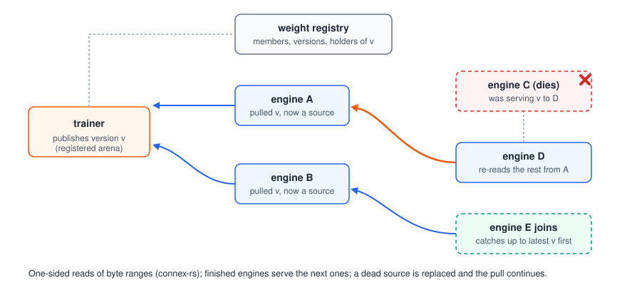

# RL post-training: elastic weight sync (`connex.rl`)

<p align="center"></p>

`connex.rl` moves new policy weights from a trainer to a pool of rollout
engines that can grow, shrink and fail while training runs, and routes
rollouts so that no request is ever generated by two weight versions.
Design and the survey of what vLLM and SGLang expose:
[`design/rl-and-agent-migration.md`](design/rl-and-agent-migration.md).
Numbers: [`results.md`](results.md#8-rl-weight-sync).

## Pieces

| Piece | What it does | Where |
|---|---|---|
| `WeightPublisher` | packs the trainer's tensors into a registered, double-buffered arena and publishes version `v` with a manifest | `connex/rl/sync.py` |
| `WeightSubscriber` | pulls the latest version with one-sided reads (a window of chunks in flight), from the trainer or from engines that hold it; replaces a source that fails mid-pull; commits and becomes a source | `connex/rl/sync.py` |
| `WeightRegistry` (+ HTTP server/client) | members by logical id and their versions, holders of each version, fan-out assignment, heartbeats and expiry | `connex/rl/registry.py` |
| `RolloutPool` | admits a request at the pool version, runs it only on an instance at that version; drains (or aborts and restarts) before updating an instance; rolling updates; drops failed instances | `connex/rl/rollout.py` |
| vLLM backend | `connex` backend for vLLM's pluggable weight transfer (`--weight-transfer-config '{"backend": "connex"}'`), worker and trainer side; registered through the `vllm.general_plugins` entry point | `connex/rl/vllm_backend.py` |
| SGLang hook | custom weight loader (`--custom-weight-loader connex.rl.sglang_ext.connex_load`) driven by `update_weights_from_tensor` | `connex/rl/sglang_ext.py` |
| HTTP instances | `VLLMInstance`, `SGLangInstance` for `RolloutPool` | `connex/rl/engines.py` |

Transports: `connex-rs` (RDMA/GPUDirect, default) and `local` (in-process,
for tests). The registry client never uses `HTTP(S)_PROXY`.

## vLLM

Requires a vLLM with the pluggable weight-transfer API
(`vllm.distributed.weight_transfer`; tested with 0.32.0 and `main` of
2026-10-23). Install Connex and connex-rs in the engine's environment, then:

```bash
VLLM_SERVER_DEV_MODE=1 vllm serve Qwen/Qwen2.5-0.5B-Instruct --port 8101 \
    --weight-transfer-config '{"backend": "connex"}'
python examples/rl/vllm_weight_sync.py --model Qwen/Qwen2.5-0.5B-Instruct \
    --engines http://127.0.0.1:8101
```

The example publishes three versions (original, perturbed, original) and
checks that greedy outputs follow them. In a trainer, the backend is used
like the built-in ones:

```python
from vllm.distributed.weight_transfer.base import ModuleSource
from vllm.distributed.weight_transfer.clients import HTTPVLLMWeightSyncClient
from connex.rl.vllm_backend import (ConnexTrainerInitInfo,
                                    ConnexTrainerWeightTransferEngine, PoolClient)

engine = ConnexTrainerWeightTransferEngine.trainer_init(
    ConnexTrainerInitInfo(rank=0, registry_url="http://trainer-host:29700"),
    client=PoolClient({u: HTTPVLLMWeightSyncClient(u) for u in engine_urls}),
    source=ModuleSource(model))
engine.send_weights()          # once per step
```

`PoolClient` drives many engines in parallel and drops an engine that fails
instead of failing the round.

## SGLang

```bash
python -m sglang.launch_server --model-path Qwen/Qwen2.5-0.5B-Instruct --port 30000 \
    --custom-weight-loader connex.rl.sglang_ext.connex_load
python examples/rl/sglang_weight_sync.py --model Qwen/Qwen2.5-0.5B-Instruct \
    --engines http://127.0.0.1:30000
```

Tested with SGLang 0.5.9 and 0.5.22. The update is one
`/update_weights_from_tensor` call (inside `begin_weight_update` /
`end_weight_update` on servers that have them) whose payload is a
control record (registry URL, version); SGLang runs the loader in every TP
scheduler process between scheduler steps and reports the version per
request (`meta_info.weight_version`).

## GRPO with churn

`examples/rl/grpo_churn.py` trains a small model with a GRPO-style objective
on synthetic arithmetic, with rollouts on `vllm serve` engines managed by
`RolloutPool`. `--kill STEP:PORT` kills an engine in the middle of that
step's rollouts, `--join STEP:GPU:PORT` starts one that catches up before
it serves:

```bash
python examples/rl/grpo_churn.py --model /path/Qwen2.5-0.5B-Instruct \
    --engines 1:8111,2:8112 --device cuda:1 --steps 8 --task reason --max-tokens 192 \
    --kill 3:8112 --kill-after 1.5 --join 5:2:8113 --out grpo.jsonl
```

Each step prints the reward, rollout goodput, publish and pool-update
times, the versions and instances that served the step's rollouts, pool
counters (restarts, failures) and the registry's view of members.

## Weight-sync benchmark

`benchmarks/rl/weight_sync_bench.py` measures the time until every receiver
holds a new version, Connex vs a chunked NCCL broadcast of the same packed
buffer, with synthetic bf16 weights sized like Qwen2.5-0.5B, Qwen2.5-1.5B
and Llama-3-8B. `local` runs on one host; `dist` runs one process per host
(`benchmarks/rl/k8s_weight_sync.py` emits the pods).

## Limits

* Every TP rank pulls the whole model and `load_weights` shards it.
* The registry is one process holding soft state; not replicated.
* Rollouts aborted for an update restart at the new version (no per-token
  version spans).
* Fan-out is per finished copy: when all engines start pulling at once,
  they all read from the trainer; peers serve only engines that start
  later. Chunk-level relaying is not implemented.
